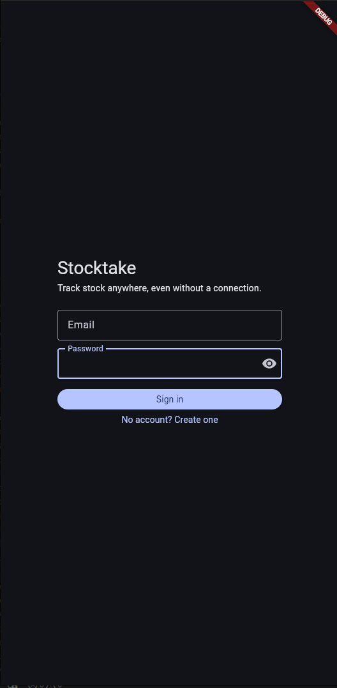
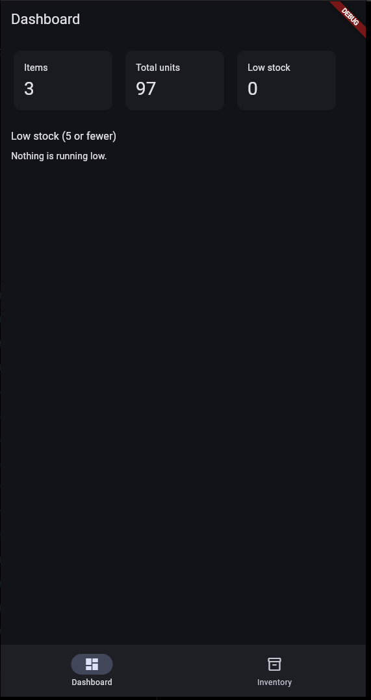
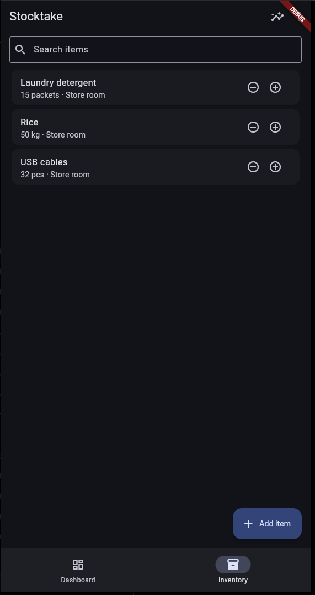
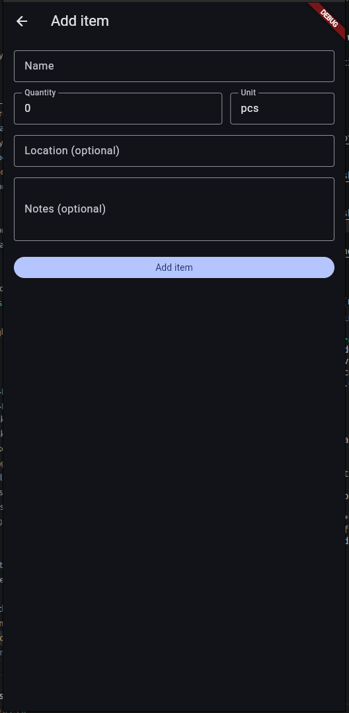

# Stocktake

**An inventory app that keeps working with no internet, and catches up on its own when the connection comes back.**

Built for places where connectivity is unreliable: a store room, a farm shed, a delivery truck. Every change is saved on the device first, so the app is never waiting on the network.

## Screenshots

### Sign In


### Dashboard


### Inventory


### Add Item


## Features

- Add, edit and delete items (name, quantity, unit, location, notes) with **no connection needed**
- Quick **+ / −** buttons on every item, and search
- Each item shows whether it is **synced**, **waiting to sync** or **failed**
- **Automatic sync** with retry and backoff when the connection returns
- **Conflict handling**: when two devices edit the same item, the newest edit wins
- Dashboard with totals and a low-stock list
- **CSV export** (copy to clipboard)
- Optional accounts through Supabase, with Row Level Security so users only see their own data
- Works on its own with no backend: without Supabase settings the app is a local-only inventory

## How the sync works

```
UI (Riverpod)  ->  InventoryRepository  ->  local SQLite database (Drift)   <- the source of truth
                                                    ^
                                                    |  pull what changed, merge, push what is pending
                                              SyncService  <->  Supabase (Postgres + Row Level Security)
```

1. **Local first.** Every change is written to the on-device database immediately and marked `pending`. The UI reads only from the local database, so it is always fast and never blocked by the network.
2. **Each item carries its own sync state** (`synced`, `pending`, `failed`). "What still needs sending" is simply "every item that is not synced", so there is no separate queue to keep consistent.
3. **A sync is: pull, merge, push.** It asks the server for everything that changed since the last pull, merges it, then sends whatever is still pending.
4. **Last write wins.** The version with the newer `updated_at` survives. The database enforces the same rule with a trigger, so an old edit can never overwrite a newer one, even if a device is slow to reconnect.
5. **Deletes are soft.** A deleted item stays as a hidden row until the deletion has reached the server and other devices.
6. **Offline is not an error.** If the server cannot be reached, items stay pending and no attempt is counted against them. If the server *rejects* an item, only that item is retried, after 5s, 10s, 20s... up to 15 minutes, and after 5 rejections it is marked `failed` until the user taps "Retry failed items".
7. **No lost edits.** If an item is edited while its previous version is being sent, it stays pending and goes out next time.
8. **Accounts don't mix.** If a different account signs in on the same device, the local copy is cleared first.

## Decisions and trade-offs

- **State on the row instead of an outbox table.** Simpler to keep correct, and it works naturally with last-write-wins. The cost is that only the latest version of an item is sent, not every intermediate edit. That is what this app wants.
- **Client-generated UUIDs** so items can be created before they have ever reached the server.
- **Two timestamps.** `updated_at` is when the user edited (used to pick the winner); `server_updated_at` is when the server stored it (used as the "changes since" cursor, so a device with a wrong clock cannot make changes invisible to others).
- **Business logic is plain Dart.** The sync service, backoff, stats and CSV code take plain data, and the sync tests run it against an in-memory database and a fake server.

## Run it

```bash
flutter pub get
dart run build_runner build --delete-conflicting-outputs
flutter test
flutter run -d chrome        # or an Android device or emulator
```

That runs the app in **local-only mode**. To turn on accounts and sync:

1. In the Supabase SQL editor, run `supabase/schema.sql`.
2. Copy `env.example.json` to `env.json` and fill in your project URL and publishable key (never the secret key).
3. Run with `flutter run -d chrome --dart-define-from-file=env.json`.

### Running in Chrome

The browser needs two extra files in `web/`, which Drift uses to run SQLite in the browser: `sqlite3.wasm` and `drift_worker.js`. Download the versions that match your installed packages (`flutter pub deps | grep -E "drift|sqlite3"`) from the releases pages of [drift](https://github.com/simolus3/drift/releases) and [sqlite3.dart](https://github.com/simolus3/sqlite3.dart/releases). On Android and desktop this is not needed.

### Android release builds

Add `<uses-permission android:name="android.permission.INTERNET"/>` to `android/app/src/main/AndroidManifest.xml` before building a release APK.

## Limitations and what I'd do next

- **Whole-item conflicts.** Two devices editing different fields of the same item at the same time resolve to the newest edit, not a field-by-field merge.
- **Quantity edits are not merged.** Two devices adjusting stock offline will overwrite each other. Recording stock *movements* (+3, -1) instead of absolute counts would fix this.
- **Deleted rows are never purged** from the server.
- **Pull limit.** One pull fetches up to 5,000 changed items; larger gaps catch up over several syncs.
- **No push-notification or background sync.** Sync runs while the app is open.
- **Clearing data on a different account** is the only protection for shared devices. There is no on-device encryption.
